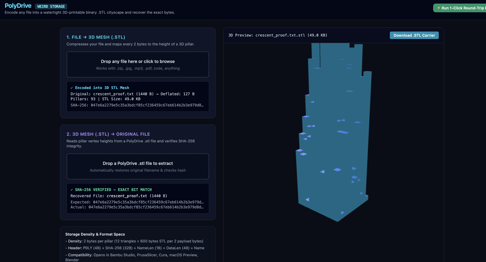

# PolyDrive: Store Any File Inside a 3D-Printable `.STL` Mesh

**PolyDrive** encodes any arbitrary file (`.zip`, `.jpg`, `.mp3`, `.pdf`, etc.) into a valid, watertight binary `.stl` 3D cityscape model and decodes the exact original bytes back from the mesh geometry.

## Live Demo
- **Web App:** `https://polydrive-stl.vercel.app`
- **Sample Carrier Included:** `crescent_proof.txt.stl` (drop this file into the decoder on the web app to extract the original file)

## How the Encoding Works
1. **Hash and Compress:** Computes the raw 32-byte `SHA-256` digest of the input file and compresses the payload using `deflate`.
2. **Binary Header:** Prepends a custom header before the compressed bytes:
   - `MAGIC` (`4 bytes`): `0x50 0x4F 0x4C 0x59` (`"POLY"`)
   - `SHA256` (`32 bytes`): Original file digest for automatic verification
   - `NAME_LEN` (`1 byte`): Filename byte length (`0` to `255`)
   - `DATA_LEN` (`4 bytes`): Big-endian `uint32` compressed payload size
   - `FILENAME` (`NAME_LEN bytes`): UTF-8 original filename
3. **Geometry Mapping:** Splits the packed byte stream into `uint16` chunks (`2 bytes` per pillar) arranged on an $N \times N$ grid. Each pillar is extruded to height $Z = 2.0 + (\text{uint16} / 1000.0)\text{ mm}$ with 4 side walls and a shared baseplate, forming a valid watertight binary `.stl`.
4. **Decoding:** Parses all top-face triangles (`normal.z > 0.99`), sorts columns by `(Y, X)` coordinates, recovers each `uint16` from the Z vertex height, decompresses, and verifies the `SHA-256` hash.

## Storage Capacity and Verification
- **Density:** `2 bytes` per 3D pillar (`600 bytes` of binary STL geometry per `2 bytes` of compressed data)
- **Tested Round-Trip Verification:**
  - Input (`crescent_proof.txt`): `SHA-256` matched bit-for-bit on extraction